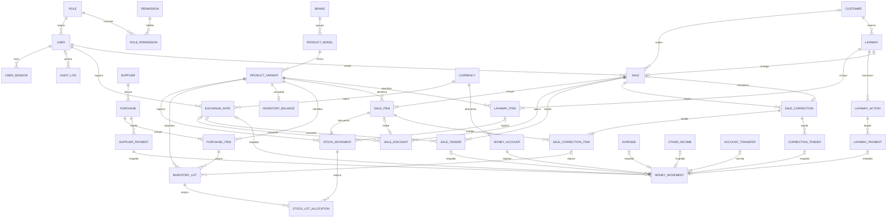

# Modelo de dominio

Las migraciones vigentes contienen usuarios, catálogos, compras, ventas, apartados, cambios, devoluciones, movimientos monetarios y de inventario. El diagrama incluye relaciones previstas para fases posteriores.

## Identidad y catálogos

- Identificadores UUID para entidades y códigos explícitos para monedas, roles y permisos. El correo se guarda normalizado. La API consulta los permisos de la sesión por acción, y el portal utiliza los mismos códigos para mostrar rutas y controles.
- Marca y modelo tienen claves normalizadas para búsqueda y unicidad. El SKU es único. La combinación modelo, talla y clave de color es única, incluso cuando el color está vacío. El formulario inicial ofrece tallas enteras 28–44.
- La configuración almacena zona horaria y umbral general. La variante puede personalizar el umbral. Los catálogos con historial se desactivan conservando sus identificadores. El POS puede representar a consumidor final mediante una venta sin cliente identificado. Un apartado requiere cliente.

## Inventario y documentos

- Cada variante cumple `0 ≤ reservado ≤ físico` y `disponible = físico − reservado`. Las reservas se respaldan con líneas de apartado y el físico con movimientos trazables. Los lotes conservan cantidad inicial, saldo y costo histórico.
- El borrador guarda la selección de modelos y tallas. Al recibir se materializan los renglones inmutables con marca, modelo, talla, SKU, cantidad, precio y costos. Se reutilizan marca y modelo por sus claves normalizadas, y las variantes por modelo, talla y clave de color.
- Las compras guardan la revisión del borrador y la clave de confirmación. Cada pago guarda su moneda, importe, cotización, cuenta y USD histórico. Los movimientos existentes fijan la moneda de una cuenta y la identidad de talla, modelo y color de una variante.
- FIFO ordena por recepción y luego por identificador para desempatar. El costo de cada salida queda aplicado a los lotes correspondientes, incluso con partidas a tasas distintas.
- Cada venta POS se confirma con un comprobante único y comprador opcional. Guarda el actor, el vendedor, los nombres comerciales, el SKU, la talla, los precios y los descuentos vigentes al confirmar. Cada línea enlaza su salida de stock y las asignaciones FIFO.
- Compras y apartados tienen estados explícitos. El apartado congela cantidades, precio y política. Sus transiciones suman abonos y registran la entrega, cancelación o cierre por vencimiento mediante eventos inmutables. La reserva y su liberación usan movimientos de reserva con delta físico cero.
- Para cambios y devoluciones, la suma de unidades devueltas queda limitada a lo vendido por línea, también si llegan peticiones concurrentes. Las unidades reingresables crean lotes vinculados a la asignación FIFO original. Las defectuosas conservan el costo reconocido en la venta.

## Dinero e indicadores

- Cada importe contabilizado conserva moneda, importe original, tasa y convención, USD histórico, momento, cuenta cuando mueve caja, autor y origen. Corregir una tasa archiva el original y agrega una versión que lo referencia mediante `replacesId`. Archivar conserva los datos y su autor. Los documentos confirmados conservan su instantánea.
- La moneda contable es USD. `USD = importe original / unidades por USD`. USD usa tasa 1. COP, VES y USDT necesitan una tasa positiva confirmada. Para conocer la precisión y redondeo, consulta [las decisiones de arquitectura](decisions.md).
- `ventas netas = ventas confirmadas − descuentos − rectificaciones por devoluciones`. La fecha de la venta es la confirmación o entrega. El ticket promedio divide ventas netas entre el número de ventas del conjunto filtrado cuando el divisor es positivo.
- `COGS = costo FIFO de unidades vendidas − ajustes de costo reconocidos en devoluciones`. Un par defectuoso sin recuperación no restaura el costo de inventario y se identifica en el ajuste. `utilidad bruta = ventas netas − COGS`. `margen bruto = utilidad bruta / ventas netas` cuando las ventas netas son positivas.
- `utilidad neta estimada = utilidad bruta − gastos operativos` en la vista de operación comercial. Otros ingresos y diferencias de cambio se muestran por separado con trazabilidad a su origen.
- Los cobros de venta son flujos de dinero efectivo por cuenta. Los anticipos se identifican al cobrar, se aplican al entregar y se cuentan una sola vez en caja. Un pago a proveedor reduce caja y la cuenta por pagar. Una compra recibida incrementa inventario.
- Cada cobro de una venta POS crea una entrada por cuenta y cada vuelto crea una salida de su caja. La suma en USD de entradas menos vuelto coincide con el total de la venta. Los descuentos se aplican primero a la línea y luego al saldo restante de todo el carrito.
- Una devolución rectifica el precio neto original de las unidades seleccionadas. Un cambio rectifica la venta de origen y registra el nuevo par en un comprobante enlazado. Solo la diferencia produce un cobro o reembolso adicional.
- `saldo de cuenta = entradas − salidas` en su moneda. El flujo de caja agrupa importes realizados por fecha de movimiento. El flujo operativo excluye transferencias internas. Los saldos consolidados históricos usan los equivalentes USD registrados, junto con el desglose original.
- Cuentas por pagar y por cobrar se calculan desde el saldo de documentos y sus abonos en USD histórico. Un apartado pendiente se presenta como compromiso o saldo de apartado, separado de las ventas.
- El valor de inventario suma unidades disponibles y reservadas de los lotes físicos por su costo histórico. Los puntos de corte son intervalos `[inicio, fin)` en la zona horaria de la tienda.
